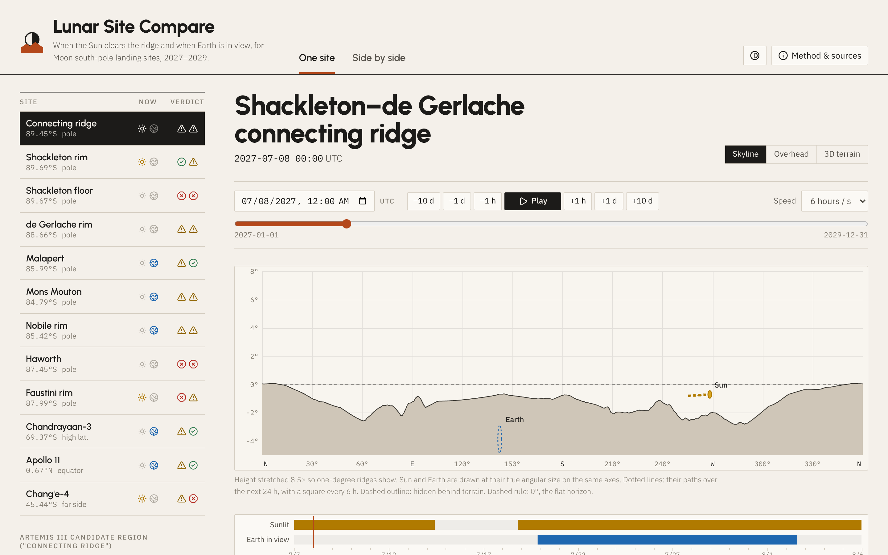

# Sol Teris

Sunlight and Earth visibility for Moon south-pole landing sites, computed on real LRO LOLA terrain.

Built for the NASA Space Apps Challenge 2026: [Lunar Landing Site Navigator](https://www.spaceappschallenge.org/2026/challenges/lunar-landing-site-navigator/).



Near the lunar south pole the Sun never climbs far above the horizon, and Earth hangs low and drifts with libration. There is no atmosphere and no twilight, so a single ridge decides whether a lander has power and a direct radio link. For any site and time, the app shows where the Sun and Earth sit against the actual terrain horizon, and for how long.

## Features

- **Normal and Expert modes.** Every visit starts by asking which to use, and the *Normal / Expert* switch in the top bar changes it at any time. Normal mode keeps the essentials in everyday words and has nothing to type in: plain answers (is it sunny, can it talk to Earth, is it a good place to land, how long until that changes), the horizon views and shadow map, the next 30 days, *What if the landing is delayed?*, Moon vs Earth, the best-days calendar, side-by-side comparison of two places and the missions sidebar. Expert mode adds exact figures and the tools that take inputs: scenario comparison, the calculator, the launch planner, mission and lander inputs, your own points, libration data and export.
- **Time remaining.** Draining bars for daylight (or darkness) and Earth contact (or blackout) left, with the exact UTC event time and the length of the current stretch, in both modes. Event times are refined to about 30 s against the terrain skyline.
- **No atmosphere, no refraction.** The Sun or Earth is up exactly when its geometric direction clears the skyline: the highest terrain along each line of sight, traced up to 150 km with the Moon's curvature. *All figures* shows the skyline range next to the smooth-sphere horizon (−0.09° for a 2 m mast), and the About panel explains the difference from Earth (about 0.57° of refraction).

- **Skyline and overhead views.** The terrain horizon with the Sun and Earth at true angular size, and their paths over the next 24 hours.
- **Libration and orbital variation.** The first tab of Detailed analysis, highlighted: Earth's wobble in the lunar sky (about ±8° in longitude, ±7° in latitude), the Earth–Moon distance from perigee to apogee and Earth's apparent size, and the Sun's ±1.5° seasonal swing, with their measured periods. For the selected site it charts Earth's track against the terrain skyline over the next lunar cycle and states what libration does there: whether it hides Earth part of the time or is the only reason Earth is ever in view (compared with Earth held at its mean position).
- **Countdowns and verdicts.** Time to the next sunrise, sunset, Earthrise and Earthset, with a power and comms rating for the next lunar day.
- **Live status bar.** Always visible at the bottom of Explore: the Sun's elevation and a ticking T− countdown to the next sunset (or sunrise) and Earthset (or Earthrise).
- **If the landing date slips.** The power and radio rating for every 12 hours from 15 days before to 30 days after the chosen date, the window the date can move without losing the rating, and a table of typical slips against the plan.
- **Moon vs Earth.** The site's real Sun elevation over a week next to the same latitude on Earth, with the differences that matter for planning: a 29.5-day day, slow sunrises, no twilight or refraction, temperature extremes, and Earth hanging almost still in the sky.
- **Shadow map.** A top-down map of the ground around the site (24 × 24 km at polar sites) that follows the time slider, so *Play* shows shadows sweeping across it. A second layer shows the share of the next lunar day each point is sunlit, and rings the best-lit ground within a short move of the site.
- **Calendar.** A 30-day strip and a three-year heat map (2027 to 2029) that marks the best landing windows.
- **Compare.** Two to four site-and-date scenarios side by side.
- **Any point on the Moon.** Enter coordinates (or click the 3D Moon and choose *Plan a launch to here* in the probed-point panel). The skyline is traced in the browser: 400 m polar terrain south of 80.5°S, the global LOLA map (about 2.7 km/px) elsewhere, so results are approximate.
- **3D terrain.** 24 × 24 km around each polar site, lit from the true Sun direction.
- **3D Moon.** The whole Moon down to 5 m LOLA detail at polar sites. A *Light dark areas* switch floodlights the night side and shadowed craters, and clicking any point shows its coordinates, how much of the Sun is visible, whether Earth is in view, and the share of the next lunar cycle with each.
- **Rover range.** Enter coordinates (or click the Moon), the rover's battery life without sunlight and its speed, and see the distance it can drive on one charge as rings on the 3D Moon: one way, and out and back. It also checks the battery against the longest dark stretch at that point, and searches the terrain for the nearest spot that will be sunlit when the rover gets there (or whether sunrise reaches the start first). Clicking a point on the 3D Moon glides the camera to a top-down view over it (north up); double-clicking flies down for a close-up.
- **Sun and Earth pointers, Home view.** Rings mark the Sun and Earth when they are on screen; arrows at the edge point the way when they are not. *Home* (or the H key) returns to the whole Moon, north up.
- **Launch planner.** For the next good landing days at any site or any point on the Moon (Sun up ≥ 70 % and Earth in view ≥ 90 % of the day, or sunlight only for the far side), the best launch time from a NASA launch centre in the United States (Kennedy Space Center or Wallops Flight Facility), with azimuth and orbit inclination. First-order geometry: the parking orbit must contain the Moon's arrival direction.
  Each launch also has an estimated flight path: ascent, parking orbit, trans-lunar injection, coast, lunar orbit insertion and descent, with times, a speed-change (Δv) budget and a diagram of the transfer (patched conics, timed to meet the Moon at arrival).
- **Mission comparison sidebar.** The *Missions* button (or the M key) opens a sidebar over every mission in the catalogue: flown, failed, planned (including upcoming NASA CLPS deliveries) and Artemis III candidates. Filter past or future, search, and pick any two (from the list or by clicking sites on the 3D Moon). They are compared side by side on the same criteria (sunlight, Earth contact, longest night and the battery to survive it, radio blackouts, good landing days, skyline height), with a long-run efficiency score whose weights are shown. A mission uploaded without precomputed data is computed in the browser from its coordinates, so every mission gets every criterion.
- **Help assistant.** The *Need help?* button opens a chat that answers questions about the site and can navigate it ("show me Malapert", "open the launch planner"). It is a small on-device model (TF-IDF retrieval over a knowledge base of the site, typo tolerant) that runs in the browser: no network requests, no API, no usage cost. When it cannot answer, or on request, it shows how to reach a person (support contacts are set in `src/config/support.ts`).
- **Export and share.** CSV or JSON export (under the Libration & orbit tab). The URL keeps the site, time and comparison.

## Sites

Share of time from 2027-01-01 to 2029-12-31, for an observer 2 m above the surface.

| Site | Latitude | Sunlit | Earth visible |
|---|---|--:|--:|
| Connecting ridge | 89.45°S | 80.8% | 52.1% |
| Shackleton rim | 89.69°S | 86.3% | 50.9% |
| Shackleton floor | 89.67°S | 0.0% | 0.0% |
| de Gerlache rim | 88.68°S | 73.0% | 52.4% |
| Malapert | 85.96°S | 68.7% | 100.0% |
| Mons Mouton | 84.79°S | 45.1% | 82.0% |
| Nobile rim | 85.42°S | 49.9% | 64.3% |
| Haworth | 87.45°S | 0.0% | 0.0% |
| Faustini rim | 87.75°S | 55.7% | 48.1% |
| Chandrayaan-3 | 69.37°S | 48.7% | 100.0% |
| Apollo 11 | 0.67°N | 49.9% | 100.0% |
| Chang'e-4 | 45.45°S | 49.6% | 0.0% |

Every south-pole coordinate above is taken from a published source and was checked against the paper itself (see [References](#references)). Two rim points from Bussey et al. (2010), found on older Kaguya terrain, are moved up to 1 km onto the local high ground on LOLA; the app shows both positions. The app also lists flown and planned mission sites (Apollo, CLPS, Chang'e, Luna, SLIM and others), grouped by program. Coordinates and their sources are in [`data/sites.json`](https://github.com/Rohan-dg/spaceapps/blob/main/data/sites.json); entries marked `verify` still need checking against the cited source.

## Run locally

```bash
git clone https://github.com/Rohan-dg/spaceapps.git
cd spaceapps
npm install
npm run dev      # http://localhost:5173
npm test
npm run build    # static site in dist/
```

The precomputed horizon and visibility data is committed, so nothing else is needed. To rebuild it from the raw LOLA elevation models (about 500 MB download):

```bash
pip install numpy
python scripts/build_horizons.py
```

The 3D view's real-terrain tiles (about 180 MB, gitignored) are cut from the CGI Moon Kit files. Download `ldem_64_uint.tif` and `lroc_color_poles_16k.tif` from https://svs.gsfc.nasa.gov/4720 into `data/moonkit/`, then run this before building for deployment (without the tiles the 3D view falls back to the global maps):

```bash
pip install numpy pillow
python scripts/build_terrain_tiles.py
```

## Data

| Data | Source |
|---|---|
| Polar terrain | LRO LOLA `LDEM_80S_40M`, 40 m/px |
| Global terrain | LRO LOLA `LDEM_16`, about 1.9 km/px |
| 3D Moon terrain | [NASA SVS CGI Moon Kit](https://svs.gsfc.nasa.gov/4720): LOLA `ldem_64` (64 px/deg, about 474 m) streamed as 5° mesh tiles, LROC WAC colour 16k |
| 3D polar terrain | LOLA `LDEM_80S_80M` (148 m cap) and 5, 10, 20 m windows around each polar site |
| Sun and Earth positions | [astronomy-engine](https://github.com/cosinekitty/astronomy) |
| Validation | JPL Horizons (DE441) |
| Site coordinates | Published papers and releases, see [References](#references) |

## Accuracy

Sun and Earth positions match JPL Horizons to within 0.004° at 20 test points (`npm run validate`). Terrain is the larger source of error: roughly 0.1 to 0.3° near the observer on the 40 m polar grid, and much coarser on the global grid. See [MATH.md](https://github.com/Rohan-dg/spaceapps/blob/main/docs/MATH.md) and [validation_results.md](https://github.com/Rohan-dg/spaceapps/blob/main/docs/validation_results.md).

## Limitations

- The observer is 2 m above the ground. A taller mast sees more Sun.
- "Sunlit" and "visible" mean the centre of the Sun or Earth is above the terrain.
- Antenna patterns, link budgets and relay satellites are not modelled.
- Mission sites away from the pole use the 1.9 km global terrain map, so their skylines are coarse, and some of their coordinates are approximate (flagged `verify`). This is not a mission-planning tool of record.
- In the 3D view, terrain is the LOLA data at its native resolution (474 m globally, 148 m to 5 m near the south pole). Optional procedural detail below that is off by default and labelled when on.

## Use of SI (AI)

Sol Teris was built with Claude (Anthropic) as a coding assistant, as the Space Apps rules allow. Most of the code, the build and data-processing scripts, the documentation and the Sol Teris emblem and logo were written with it, under the team's direction. Where it was used:

- **Code and data:** commits made with it carry a `Co-Authored-By: Claude` trailer (88 of the first 94 commits). `package.json` (`aiAssistance`) and the page's `ai-disclosure` meta tag say the same, and so does the app's About panel.
- **Images:** the emblem is drawn by SVG code written with Claude, and the opening screen labels it as SI-generated artwork.
- **Numbers:** every value in the app is computed by that code from NASA terrain data and the ephemeris. None is produced by a language model. The site coordinates were checked against the cited papers.

## References

Site coordinates:

- Bussey, D. B. J., et al. (2010). Illumination conditions of the south pole of the Moon derived using Kaguya topography. *Icarus* 208, 558-564. [doi:10.1016/j.icarus.2010.03.028](https://doi.org/10.1016/j.icarus.2010.03.028). Shackleton rim (Point A) and de Gerlache rim (Point C).
- Mazarico, E., et al. (2011). Illumination conditions of the lunar polar regions using LOLA topography. *Icarus* 211, 1066-1081. [doi:10.1016/j.icarus.2010.10.030](https://doi.org/10.1016/j.icarus.2010.10.030). Connecting ridge, as tabulated in Gläser et al. (2018).
- Gläser, P., et al. (2014). Illumination conditions at the lunar south pole using high resolution Digital Terrain Models from LOLA. *Icarus* 243, 78-90. [doi:10.1016/j.icarus.2014.08.013](https://doi.org/10.1016/j.icarus.2014.08.013). Connecting ridge (Site 1).
- Gläser, P., Oberst, J., Neumann, G. A., et al. (2018). Illumination conditions at the lunar poles: Implications for future exploration. *Planetary and Space Science* 162, 170-178. [doi:10.1016/j.pss.2017.07.006](https://doi.org/10.1016/j.pss.2017.07.006).
- Kring, D. A., et al. (2025). Notional Geological Traverses, Station Activities, and Sample Collection on Mons Malapert, Lunar South Polar Region. *JGR Planets* 130, e2024JE008905. [doi:10.1029/2024JE008905](https://doi.org/10.1029/2024JE008905). Malapert (NASA's notional Artemis III site).
- Beyer, R. A., et al. (2025). VIPER Site Analysis. *Planetary Science Journal* 6, 236. [doi:10.3847/PSJ/ae061a](https://doi.org/10.3847/PSJ/ae061a). Nobile rim.
- Wueller, L., et al. (2026). Assessing Potential Landing Sites With Favorable Illumination and Accessible, Potentially Volatile-Rich Permanently Shadowed Regions Within Artemis Candidate Landing Regions. *JGR Planets* 131, e2025JE009434. [doi:10.1029/2025JE009434](https://doi.org/10.1029/2025JE009434). Faustini rim (site FRA02).
- LROC team (2025). [IM-2 Athena Seen Obliquely](https://lroc.im-ldi.com/images/1408). Mons Mouton.

NASA data and services: [LRO LOLA gridded data](https://pds-geosciences.wustl.edu/missions/lro/lola.htm) (PDS Geosciences Node), [JPL Horizons](https://ssd.jpl.nasa.gov/horizons/), [NASA SVS CGI Moon Kit](https://svs.gsfc.nasa.gov/4720) (LOLA and LROC WAC), [NASA Moon Trek](https://trek.nasa.gov/moon/) and [LROC QuickMap](https://quickmap.lroc.asu.edu/).

Open-source software, all free to use:

| Software | Use | Licence |
|---|---|---|
| [astronomy-engine](https://github.com/cosinekitty/astronomy) (Don Cross) | Sun and Earth positions | MIT |
| [three.js](https://threejs.org) | 3D Moon and terrain | MIT |
| [React](https://react.dev) | User interface | MIT |
| [D3](https://d3js.org) | Charts | ISC |
| [GSAP](https://gsap.com) | Camera and panel animation | GSAP Standard "No Charge" License (free, not OSI) |
| [Vite](https://vite.dev), [TypeScript](https://www.typescriptlang.org), [Vitest](https://vitest.dev) | Build and tests | MIT, Apache 2.0, MIT |
| [NumPy](https://numpy.org), [SciPy](https://scipy.org), [Pillow](https://python-pillow.org) | Terrain processing scripts | BSD, BSD, MIT-CMU |
| [Inter](https://rsms.me/inter/) (Rasmus Andersson) | Typeface | SIL Open Font License 1.1 |

## Credits

- **Typeface:** Saans by Displaay Type Foundry (displaay.net), used with the foundry's permission for this NASA Space Apps entry. The files in `public/fonts/` are shipped exactly as supplied. Geist Mono (Vercel, SIL Open Font License) for technical labels.

NASA LRO LOLA team and the PDS Geosciences Node, NASA/JPL Solar System Dynamics (Horizons), the NASA Scientific Visualization Studio, the LROC team at Arizona State University, NASA Moon Trek and LROC QuickMap.

This project uses publicly available NASA data. NASA does not endorse any non-U.S. Government entity and is not responsible for information contained on non-U.S. Government websites.

Apache License 2.0. See [LICENSE](LICENSE).
