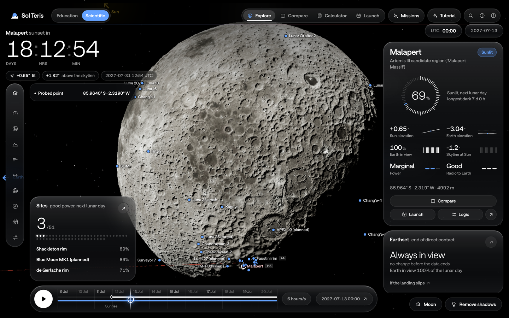

# Sol Teris

Sunlight and Earth visibility for Moon south-pole landing sites, computed on real LRO LOLA terrain.

**Live site: <https://sol.teris.workers.dev/>**

Built for the NASA Space Apps Challenge 2026: [Lunar Landing Site Navigator](https://www.spaceappschallenge.org/2026/challenges/lunar-landing-site-navigator/).



Near the lunar south pole the Sun never climbs far above the horizon, and Earth hangs low and drifts with libration. There is no atmosphere and no twilight, so a single ridge decides whether a lander has power and a direct radio link. For any site and time, the app shows where the Sun and Earth sit against the actual terrain horizon, and for how long.

## Features

Every visit starts by choosing **Education** or **Scientific**; the switch in the top bar changes it at any time.

### Scientific mode

A glass dashboard over a full-screen 3D Moon. Four tabs along the top (**Explore**, **Compare**, **Calculator**, **Launch**), with **Missions**, **Tutorial**, search, About and AI help beside them, and a UTC clock and date picker below.

- **Site card.** The selected site's state now (sunlit or in shadow, Earth in view or hidden), the Sun's clearance above the terrain skyline, the share of the next lunar day with sunlight and with Earth in view, and live countdowns to the next sunrise, sunset, Earthrise and Earthset.
- **Section dock.** A row of icons on the left opens each analysis as a panel that slides over the Moon; click outside it, or press Esc, to close it:
  - **Conditions:** time controls, sunlight and Earth visibility now, the power and radio ratings for this lunar day, and the site record.
  - **Sites:** every landing site with its state now and its ratings; add your own point by coordinates.
  - **Horizon:** the terrain skyline seen from the site with the Sun and Earth at true size, as a panorama, a sky plot, a first-person view you can turn and tilt, or a shadow map of the ground around the site that follows the time slider.
  - **Next 30 days:** when the site is sunlit, when Earth is up, and when both are, day by day; click to jump to a time.
  - **Date slip:** the ratings every 12 hours from 15 days before to 30 days after the chosen date, and how far the date can move before a rating changes.
  - **Moon vs Earth:** the site's Sun next to the same latitude on Earth: a 29.5-day day, slow sunrises, no twilight, no refraction.
  - **Libration & orbit:** Earth's wobble in the lunar sky (about ±8° by ±7°), the Earth–Moon distance and the Sun's seasonal swing, and what they do to Earth contact at this site. CSV and JSON export.
  - **Calendar:** sunlight and Earth visibility for every day from 2027 to 2029, with the best landing windows marked.
  - **Mission plan:** lander inputs (solar array, battery, antenna) and the resulting power, communications and rover estimates.
  - **Compare:** two picked sites side by side, with an overall score whose weights are shown.
- **Home.** The Moon button returns to the opening view of the whole Moon with the panels hidden; *Show the panels* brings them back.
- **3D Moon.** Real LOLA relief, down to 5 m near the south-pole sites, lit by the true Sun direction. Click any point to see its coordinates, whether the Sun and Earth are up there, and the share of the next lunar cycle with each; *Remove shadows* floodlights the night side and shadowed craters.
- **Compare tab.** Up to four site-and-date scenarios side by side.
- **Calculator tab.** A solver for the planning equations behind the app (travel time, speed on a slope, terrain slope, Sun and Earth clearance over a ridge, distance to the horizon, terrain resolution, solar power, battery level, surviving the dark, driving range): pick an equation, choose what to solve for, and fill the rest by hand or from the selected site.
- **Launch tab.** The next good landing days at any site or point (Sun up at least 70% and Earth in view at least 90% of the day, or sunlight only on the far side), the best launch time from Kennedy Space Center or Wallops, with azimuth, inclination and an estimated flight path: ascent, parking orbit, trans-lunar injection, coast, lunar orbit insertion and descent, with a speed-change (Δv) budget.
- **Missions sidebar** (M key). Every mission in the catalogue (flown, failed, planned and Artemis III candidates), filterable and searchable. Pick any two to compare on sunlight, Earth contact, longest night and the battery to survive it, radio blackouts and good landing days.
- **Rover range.** Battery life and speed give the distance a rover can drive on one charge, drawn as rings on the 3D Moon, with the nearest ground that will be sunlit when it gets there.
- **Any point on the Moon.** Enter coordinates or click the globe; its skyline is traced in the browser (400 m polar terrain south of 80.5°S, the 2.7 km global map elsewhere, so results are approximate).

### Education mode

The same results in plain language, styled to match, for students and the public: what a place is and where, what it is like right now and for how long, whether it is a good place to land, what you would see standing there, the month ahead, and how the Moon differs from Earth.

- **Drive a rover.** A game on real LOLA terrain with the real Sun and Earth. Pick one of five rovers in the garage, each modelled on a real design: Badger (RASSOR), Frostbite (VIPER), Dust Devil (Apollo Lunar Roving Vehicle), Trailblazer (Artemis Lunar Terrain Vehicle) and Ranger (MoonRanger). Then play one of five missions: First Drive, Sun Sprint, Science Hunt, Ice Survey and Shadow Dive. Charge in sunlight, find Earth to send reports, dig for ice in the shadows and park somewhere safe, with a live score, combos, bonus targets and stars. See [the game notes](docs/ROVER_GAME.md).

### Both modes

- **Sol, the help assistant.** The *Need help?* button (or the ? icon) opens a chat that works answers out from the site data: "Is Apollo 11 sunlit next week?", "Malapert vs Shackleton rim", "Which site has the most sunlight?", "Best day to land at Malapert in June 2028", "How far is Apollo 11 from Apollo 17?", or "Which sites are CLPS?". It understands dates, carries on from the last site discussed, and can jump to a date or open a comparison. Questions about the app itself ("how do I change the date?") are answered from a built-in guide. Everything runs in the browser: no server, no API key, nothing typed leaves the device.
- **Time controls.** A timeline with sunrise, sunset, Earthrise and Earthset marks, play at several speeds, and a date picker; arrow keys step an hour (Shift for a day), Space plays.
- **No atmosphere, no refraction.** The Sun or Earth is up exactly when its geometric direction clears the skyline: the highest terrain along each line of sight, traced up to 150 km with the Moon's curvature.
- **Guided tour** on first visit, and **shareable links**: the URL keeps the site, time and comparison.

## Sites

Share of time from 2027-01-01 to 2029-12-31, for an observer 2 m above the surface.

| Site | Latitude | Sunlit | Earth visible |
|---|---|--:|--:|
| Connecting ridge | 89.45°S | 80.8% | 52.1% |
| Shackleton rim | 89.69°S | 86.3% | 50.9% |
| Shackleton floor | 89.67°S | 0.0% | 0.0% |
| de Gerlache rim | 88.68°S | 73.0% | 52.4% |
| Malapert | 85.96°S | 68.7% | 100.0% |
| Mons Mouton | 84.79°S | 45.1% | 82.0% |
| Nobile rim | 85.42°S | 49.9% | 64.3% |
| Haworth | 87.45°S | 0.0% | 0.0% |
| Faustini rim | 87.75°S | 55.7% | 48.1% |
| Chandrayaan-3 | 69.37°S | 48.7% | 100.0% |
| Apollo 11 | 0.67°N | 49.9% | 100.0% |
| Chang'e-4 | 45.45°S | 49.6% | 0.0% |

Every south-pole coordinate above is taken from a published source and was checked against the paper itself (see [References](#references)). Two rim points from Bussey et al. (2010), found on older Kaguya terrain, are moved up to 1 km onto the local high ground on LOLA; the app shows both positions. The app also lists flown and planned mission sites (Apollo, CLPS, Chang'e, Luna, SLIM and others), grouped by program. Coordinates and their sources are in [`data/sites.json`](https://github.com/Rohan-dg/spaceapps/blob/main/data/sites.json); entries marked `verify` still need checking against the cited source.

## Run locally

```bash
git clone https://github.com/Rohan-dg/spaceapps.git
cd spaceapps
npm install
npm run dev      # http://localhost:5173
npm test
npm run build    # static site in dist/
```

The precomputed horizon and visibility data is committed, so nothing else is needed. To rebuild it from the raw LOLA elevation models (about 500 MB download):

```bash
pip install numpy
python scripts/build_horizons.py
```

The 3D view's real-terrain tiles (about 180 MB, gitignored) are cut from the CGI Moon Kit files. Download `ldem_64_uint.tif` and `lroc_color_poles_16k.tif` from https://svs.gsfc.nasa.gov/4720 into `data/moonkit/`, then run this before building for deployment (without the tiles the 3D view falls back to the global maps):

```bash
pip install numpy pillow
python scripts/build_terrain_tiles.py
```

## Data

| Data | Source |
|---|---|
| Polar terrain | LRO LOLA `LDEM_80S_40M`, 40 m/px |
| Global terrain | LRO LOLA `LDEM_16`, about 1.9 km/px |
| 3D Moon terrain | [NASA SVS CGI Moon Kit](https://svs.gsfc.nasa.gov/4720): LOLA `ldem_64` (64 px/deg, about 474 m) streamed as 5° mesh tiles, LROC WAC colour 16k |
| 3D polar terrain | LOLA `LDEM_80S_80M` (148 m cap) and 5, 10, 20 m windows around each polar site |
| Sun and Earth positions | [astronomy-engine](https://github.com/cosinekitty/astronomy) |
| Rover model | NASA's [RASSOR model collection](https://github.com/nasa/NASA-3D-Resources), adapted into articulated, compressed GLB geometry |
| Validation | JPL Horizons (DE441) |
| Site coordinates | Published papers and releases, see [References](#references) |

## Accuracy

Sun and Earth positions match JPL Horizons to within 0.004° at 20 test points (`npm run validate`). Terrain is the larger source of error: roughly 0.1 to 0.3° near the observer on the 40 m polar grid, and much coarser on the global grid. See [MATH.md](https://github.com/Rohan-dg/spaceapps/blob/main/docs/MATH.md) and [validation_results.md](https://github.com/Rohan-dg/spaceapps/blob/main/docs/validation_results.md).

## Limitations

- The observer is 2 m above the ground. A taller mast sees more Sun.
- "Sunlit" and "visible" mean the centre of the Sun or Earth is above the terrain.
- Antenna patterns, link budgets and relay satellites are not modelled.
- Mission sites away from the pole use the 1.9 km global terrain map, so their skylines are coarse, and some of their coordinates are approximate (flagged `verify`). This is not a mission-planning tool of record.
- In the 3D view, terrain is the LOLA data at its native resolution (474 m globally, 148 m to 5 m near the south pole). Optional procedural detail below that is off by default and labelled when on.

## References

Site coordinates:

- Bussey, D. B. J., et al. (2010). Illumination conditions of the south pole of the Moon derived using Kaguya topography. *Icarus* 208, 558-564. [doi:10.1016/j.icarus.2010.03.028](https://doi.org/10.1016/j.icarus.2010.03.028). Shackleton rim (Point A) and de Gerlache rim (Point C).
- Mazarico, E., et al. (2011). Illumination conditions of the lunar polar regions using LOLA topography. *Icarus* 211, 1066-1081. [doi:10.1016/j.icarus.2010.10.030](https://doi.org/10.1016/j.icarus.2010.10.030). Connecting ridge, as tabulated in Gläser et al. (2018).
- Gläser, P., et al. (2014). Illumination conditions at the lunar south pole using high resolution Digital Terrain Models from LOLA. *Icarus* 243, 78-90. [doi:10.1016/j.icarus.2014.08.013](https://doi.org/10.1016/j.icarus.2014.08.013). Connecting ridge (Site 1).
- Gläser, P., Oberst, J., Neumann, G. A., et al. (2018). Illumination conditions at the lunar poles: Implications for future exploration. *Planetary and Space Science* 162, 170-178. [doi:10.1016/j.pss.2017.07.006](https://doi.org/10.1016/j.pss.2017.07.006).
- Kring, D. A., et al. (2025). Notional Geological Traverses, Station Activities, and Sample Collection on Mons Malapert, Lunar South Polar Region. *JGR Planets* 130, e2024JE008905. [doi:10.1029/2024JE008905](https://doi.org/10.1029/2024JE008905). Malapert (NASA's notional Artemis III site).
- Beyer, R. A., et al. (2025). VIPER Site Analysis. *Planetary Science Journal* 6, 236. [doi:10.3847/PSJ/ae061a](https://doi.org/10.3847/PSJ/ae061a). Nobile rim.
- Wueller, L., et al. (2026). Assessing Potential Landing Sites With Favorable Illumination and Accessible, Potentially Volatile-Rich Permanently Shadowed Regions Within Artemis Candidate Landing Regions. *JGR Planets* 131, e2025JE009434. [doi:10.1029/2025JE009434](https://doi.org/10.1029/2025JE009434). Faustini rim (site FRA02).
- LROC team (2025). [IM-2 Athena Seen Obliquely](https://lroc.im-ldi.com/images/1408). Mons Mouton.

NASA data and services: [LRO LOLA gridded data](https://pds-geosciences.wustl.edu/missions/lro/lola.htm) (PDS Geosciences Node), [JPL Horizons](https://ssd.jpl.nasa.gov/horizons/), [NASA SVS CGI Moon Kit](https://svs.gsfc.nasa.gov/4720) (LOLA and LROC WAC), [NASA Moon Trek](https://trek.nasa.gov/moon/) and [LROC QuickMap](https://quickmap.lroc.asu.edu/).

Open-source software, all free to use:

| Software | Use | Licence |
|---|---|---|
| [astronomy-engine](https://github.com/cosinekitty/astronomy) (Don Cross) | Sun and Earth positions | MIT |
| [three.js](https://threejs.org) | 3D Moon and terrain | MIT |
| [React](https://react.dev) | User interface | MIT |
| [D3](https://d3js.org) | Charts | ISC |
| [GSAP](https://gsap.com) | Camera and panel animation | GSAP Standard "No Charge" License (free, not OSI) |
| [Vite](https://vite.dev), [TypeScript](https://www.typescriptlang.org), [Vitest](https://vitest.dev) | Build and tests | MIT, Apache 2.0, MIT |
| [NumPy](https://numpy.org), [SciPy](https://scipy.org), [Pillow](https://python-pillow.org) | Terrain processing scripts | BSD, BSD, MIT-CMU |

## Credits

- **Typeface:** Saans by Displaay Type Foundry (displaay.net), used with the foundry's permission for this NASA Space Apps entry. The files in `public/fonts/` are shipped exactly as supplied.

NASA LRO LOLA team and the PDS Geosciences Node, NASA/JPL Solar System Dynamics (Horizons), the NASA Scientific Visualization Studio, the LROC team at Arizona State University, NASA Moon Trek and LROC QuickMap.

This project uses publicly available NASA data. NASA does not endorse any non-U.S. Government entity and is not responsible for information contained on non-U.S. Government websites.

Apache License 2.0. See [LICENSE](LICENSE).

<!-- SI disclosure (NASA Space Apps): written with SI assistance by Claude Opus 5.5 (Anthropic, 34 commits) and OpenAI Codex (OpenAI, 1 commit), under the team's direction. Attribution from the commit history. -->
